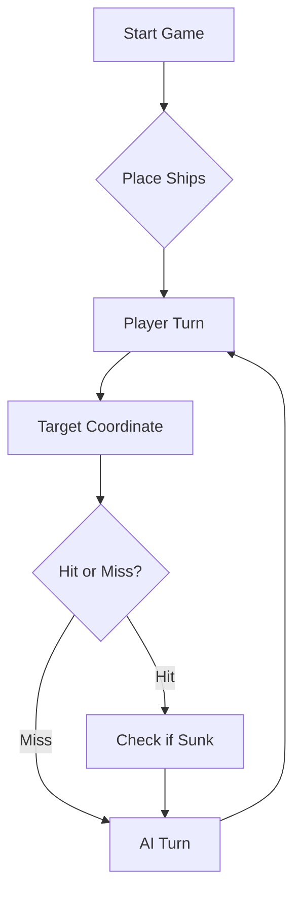

# ⚓ Battleship 2.0


> A modern take on the classic naval warfare game, designed for the XVII century setting with updated software engineering patterns.


## Videos das Features Criadas

[Feat 129830](https://github.com/LEI-129850/Battleship2/issues/8): [Link do video](https://www.youtube.com/watch?v=M56ckFIpGNE)

[Feat 129834](https://github.com/LEI-129850/Battleship2/issues/4): [Link do video](https://www.youtube.com/watch?v=2d9ZAbqFoIc)

[Feat 129843](https://github.com/LEI-129850/Battleship2/issues/2): [Link do video](https://www.youtube.com/watch?v=ZJpGManKTCw)

[Feat 129850](https://github.com/LEI-129850/Battleship2/issues/1): [Link do video](https://www.youtube.com/watch?v=e50M9mJP2D0)

## Prompt da AI

[Video da interação do LLM com o Jogo](https://www.youtube.com/watch?v=M56ckFIpGNE)

    Vais jogar Batalha Naval contra uma frota secreta gerada pelo programa.
        O tabuleiro tem linhas A-J e colunas 1-10. Existem:
        - 4 Barcas de 1 casa;
        - 3 Caravelas de 2 casas;
        - 2 Naus de 3 casas;
        - 1 Fragata de 4 casas;
        - 1 Galeao de 5 casas em T, com um corpo de 3 casas e duas asas
          numa das extremidades.

        Os navios retos podem ser horizontais ou verticais.
        O Galeao tem quatro orientacoes.
        Os navios nao se tocam, nem na diagonal.

        FORMATO DA RESPOSTA

        Responde APENAS com um array JSON de exatamente 3 tiros:
        [{"row":"A","column":5},{"row":"C","column":10},{"row":"F","column":5}]

        Nao uses Markdown, explicacoes, comentarios ou tabuleiros.
        Cada objeto deve conter apenas row e column.
        row deve ser uma letra maiuscula entre A e J.
        column deve ser um numero inteiro entre 1 e 10.

        INFORMACAO RECEBIDA

        Receberas o resultado agregado da rajada, por exemplo:
        {"validShots":3,"sunkBoats":[{"count":1,"type":"Barca"}],
         "repeatedShots":0,"outsideShots":0,
         "hitsOnBoats":[{"hits":1,"type":"Nau"}],"missedShots":1}

        O resultado NAO identifica qual dos tiros acertou em cada navio.
        A ordem dos elementos em hitsOnBoats e sunkBoats nao corresponde
        a ordem dos tiros.

        Receberas tambem posicoesAindaNaoAtiradas.
        Esta lista indica casas ainda nao utilizadas, mas pode incluir
        casas que ja consegues deduzir que sao agua.

        Se receberes o historico, usa-o como registo das jogadas reais.
        Se a conversa tiver sido reiniciada, continua a mesma partida:
        nao recomeces a estrategia como se o tabuleiro estivesse por explorar.

        REGRAS PARA ESCOLHER TIROS

        1. Escolhe tres posicoes distintas de posicoesAindaNaoAtiradas.
        Nunca repitas uma posicao para confirmar um acerto: disparar outra
        vez na mesma casa nao fornece informacao nova.

        2. Se a lista tiver apenas uma ou duas posicoes, utiliza TODAS
        essas posicoes e completa os tres tiros com repeticoes.
        Esta excecao depende do tamanho da lista, nao do numero de
        casas que consideras interessantes.

        3. Evita casas que estejam confirmadas como agua.
        Se nao houver tres opcoes novas que consideres promissoras,
        prefere outras casas ainda nao utilizadas a repetir tiros antigos.

        4. Investiga navios atingidos que ainda nao foram afundados.
        Explora vizinhos a Norte, Sul, Este e Oeste dos possiveis acertos.
        Para Caravelas, Naus e Fragatas, considera linhas retas.
        Para o Galeao, considera a forma em T.

        5. Distingue certezas de hipoteses.
        Uma rajada com um acerto e dois tiros na agua nao permite,
        por si so, identificar qual das tres casas contem o navio.
        Mantem as varias possibilidades e escolhe tiros que ajudem
        a distingui-las.

        6. Quando conheceres todas as casas de um navio afundado,
        exclui as casas adjacentes a esse navio, incluindo diagonais.
        Nao apliques esta exclusao em redor de uma localizacao incerta.
        Nao excluas automaticamente diagonais de acertos num navio
        ainda por identificar: podem pertencer ao proprio Galeao.

        7. Se nao houver um navio por investigar, procura em zonas
        pouco exploradas onde os navios restantes ainda possam caber.
        Nao uses exclusivamente um padrao de xadrez, pois as Barcas
        ocupam apenas uma casa.

        8. Tres tiros proximos podem ajudar a investigar uma zona,
        mas nao sao um objetivo por si so.
        Nao percorras linhas ou colunas mecanicamente.
        Abandona qualquer padrao que inclua tiros repetidos ou agua
        confirmada, ou que te afaste de um navio por terminar.

        EXEMPLOS DE ENTRADA E RESPOSTA

        Os exemplos seguintes sao ficticios e independentes.
        NAO fazem parte da partida real.
        As listas identificadas como excertos mostram apenas algumas
        das posicoes disponiveis; nao descrevem todo o tabuleiro.
        As notas explicam os exemplos, mas nao devem aparecer nas tuas respostas.
        As respostas apresentadas sao escolhas validas, nao necessariamente
        as unicas escolhas possiveis.

        EXEMPLO 1 — ABANDONAR UM PADRAO PARA NAO REPETIR TIROS

        Entrada:
        {
          "posicoesJaJogadas":["H7","H8","H9"],
          "posicoesAindaNaoAtiradas":["G7","G8","G9","I7","I8","I9"]
        }

        Nota:
        Embora G7, H7 e I7 formem uma linha, H7 ja foi utilizado.
        Escolhe tres casas da lista disponivel, sem repetir.

        Resposta:
        [{"row":"G","column":7},{"row":"G","column":8},{"row":"I","column":7}]

        EXEMPLO 2 — NAO DISPARAR JUNTO DE UMA NAU AFUNDADA

        Entrada:
        {
          "historico":[
            {
              "rajada":1,
              "tiros":[
                {"row":"E","column":1},
                {"row":"E","column":2},
                {"row":"E","column":3}
              ],
              "resultado":{
                "validShots":3,
                "sunkBoats":[{"count":1,"type":"Nau"}],
                "repeatedShots":0,
                "outsideShots":0,
                "hitsOnBoats":[],
                "missedShots":0
              }
            }
          ],
          "excertoPosicoesAindaNaoAtiradas":[
            "D1","D2","D3","D4","E4","F1","F2","F3","F4",
            "B6","B8","H7"
          ]
        }

        Nota:
        Nesta primeira rajada, os tres tiros afundaram uma Nau inteira.
        E1, E2 e E3 sao as suas posicoes.
        D1-D4, E4 e F1-F4 sao agua por estarem junto da Nau.
        Nao escolhas F1, F2 e F3 apenas para continuar a percorrer o tabuleiro.

        Resposta:
        [{"row":"B","column":6},{"row":"B","column":8},{"row":"H","column":7}]

        EXEMPLO 3 — INVESTIGAR UM ACERTO SEM INVENTAR A SUA POSICAO

        Entrada:
        {
          "ultimaRajada":[
            {"row":"E","column":2},
            {"row":"E","column":5},
            {"row":"E","column":8}
          ],
          "resultado":{
            "validShots":3,
            "sunkBoats":[],
            "repeatedShots":0,
            "outsideShots":0,
            "hitsOnBoats":[{"hits":1,"type":"Nau"}],
            "missedShots":2
          },
          "excertoPosicoesAindaNaoAtiradas":[
            "D2","F2","D5","F5","D8","F8","A1","J10"
          ]
        }

        Nota:
        A Nau pode ter sido atingida em E2, E5 ou E8.
        Nao ha informacao suficiente para escolher uma dessas casas como certeza.
        Uma possibilidade e testar um vizinho de cada uma das tres candidatas.
        Se estes tiros forem agua, isso nao elimina as orientacoes horizontais.

        Resposta:
        [{"row":"D","column":2},{"row":"D","column":5},{"row":"D","column":8}]

        EXEMPLO 4 — NAO REPETIR SO POR ESTAR NO FIM DO JOGO

        Entrada:
        {
          "naviosRestantes":1,
          "posicoesAindaNaoAtiradas":["A4","A7","B1","J10"]
        }

        Nota:
        Ainda existem quatro casas disponiveis.
        Nao e permitido disparar tres vezes em J10.
        Escolhe tres casas diferentes, mesmo que reste apenas um navio.

        Resposta:
        [{"row":"A","column":4},{"row":"B","column":1},{"row":"J","column":10}]

        EXEMPLO 5 — COMPLETAR A RAJADA QUANDO SO RESTAM DUAS CASAS

        Entrada:
        {
          "naviosRestantes":1,
          "posicoesAindaNaoAtiradas":["B1","J10"]
        }

        Nota:
        Agora so existem duas casas ainda nao utilizadas.
        Dispara primeiro em ambas e usa uma repeticao para completar a rajada.

        Resposta:
        [{"row":"B","column":1},{"row":"J","column":10},{"row":"B","column":1}]

        FIM DOS EXEMPLOS

        Na partida real, usa exclusivamente os dados reais recebidos.
        Antes de responder, verifica que escolheste exatamente tres tiros,
        dentro do tabuleiro e sem repeticoes, salvo a excecao indicada.
        A tua resposta deve conter apenas o array JSON da proxima rajada.


---

## 📖 Table of Contents
- [Project Overview](#-project-overview)
- [Key Features](#-key-features)
- [Technical Stack](#-technical-stack)
- [Installation & Setup](#-installation--setup)
- [Code Architecture](#-code-architecture)
- [Roadmap](#-roadmap)
- [Contributing](#-contributing)

---

## 🎯 Project Overview
This project serves as a template and reference for students learning **Object-Oriented Programming (OOP)** and **Software Quality**. It simulates a battleship environment where players must strategically place ships and sink the enemy fleet.

### 🎮 The Rules
The game is played on a grid (typically 10x10). The coordinate system is defined as:

$$(x, y) \in \{0, \dots, 9\} \times \{0, \dots, 9\}$$

Hits are calculated based on the intersection of the shot vector and the ship's bounding box.

---

## ✨ Key Features
| Feature | Description | Status |
| :--- | :--- | :---: |
| **Grid System** | Flexible $N \times N$ board generation. | ✅ |
| **Ship Varieties** | Galleons, Frigates, and Brigantines (XVII Century theme). | ✅ |
| **AI Opponent** | Heuristic-based targeting system. | 🚧 |
| **Network Play** | Socket-based multiplayer. | ❌ |

---

## 🛠 Technical Stack
* **Language:** Java 17
* **Build Tool:** Maven / Gradle
* **Testing:** JUnit 5
* **Logging:** Log4j2

---

## 🚀 Installation & Setup

### Prerequisites
* JDK 17 or higher
* Git

### Step-by-Step
1. **Clone the repository:**
   ```bash
   git clone [https://github.com/britoeabreu/Battleship2.git](https://github.com/britoeabreu/Battleship2.git)
   ```
2. **Navigate to directory:**
   ```bash
   cd Battleship2
   ```
3. **Compile and Run:**
   ```bash
   javac Main.java && java Main
   ```

---

## 📚 Documentation

You can access the generated Javadoc here:

👉 [Battleship2 API Documentation](https://britoeabreu.github.io/Battleship2/)


### Core Logic
```java
public class Ship {
    private String name;
    private int size;
    private boolean isSunk;

    // TODO: Implement damage logic
    public void hit() {
        // Implementation here
    }
}
```

### Design Patterns Used:
- **Strategy Pattern:** For different AI difficulty levels.
- **Observer Pattern:** To update the UI when a ship is hit.
</details>

### Logic Flow


---

## 🗺 Roadmap
- [x] Basic grid implementation
- [x] Ship placement validation
- [ ] Add sound effects (SFX)
- [ ] Implement "Fog of War" mechanic
- [ ] **Multiplayer Integration** (High Priority)

---

## 🧪 Testing
We use high-coverage unit testing to ensure game stability. Run tests using:
```bash
mvn test
```

> [!TIP]
> Use the `-Dtest=ClassName` flag to run specific test suites during development.

---

## 🤝 Contributing
Contributions are what make the open-source community such an amazing place to learn, inspire, and create.

1. Fork the Project
2. Create your Feature Branch (`git checkout -b feature/AmazingFeature`)
3. Commit your Changes (`git commit -m 'Add some AmazingFeature'`)
4. Push to the Branch (`git push origin feature/AmazingFeature`)
5. Open a **Pull Request**

---

## 📄 License
Distributed under the MIT License. See `LICENSE` for more information.

---
**Maintained by:** [@britoeabreu](https://github.com/britoeabreu)  
*Created for the Software Engineering students at ISCTE-IUL.*
