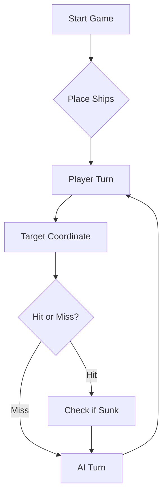

# ⚓ Battleship 2.0


> A modern take on the classic naval warfare game, designed for the XVII century setting with updated software engineering patterns.


## Videos das Features Criadas

[Feat 129830](https://github.com/LEI-129850/Battleship2/issues/8): [Link do video](https://www.youtube.com/watch?v=M56ckFIpGNE)

[Feat 129834](https://github.com/LEI-129850/Battleship2/issues/4): [Link do video](https://www.youtube.com/watch?v=2d9ZAbqFoIc)

[Feat 129843](https://github.com/LEI-129850/Battleship2/issues/2): [Link do video](https://www.youtube.com/watch?v=ZJpGManKTCw)

[Feat 129850](https://github.com/LEI-129850/Battleship2/issues/1): [Link do video](https://www.youtube.com/watch?v=e50M9mJP2D0)

## Pompt da AI

[Video da interação do LLM com o Jogo](https://www.youtube.com/watch?v=M56ckFIpGNE)


    Vais jogar Batalha Naval contra uma frota secreta gerada pelo programa.
    O tabuleiro tem linhas A-J e colunas 1-10. Existem 4 Barcas de 1 casa,
    3 Caravelas de 2 casas, 2 Naus de 3 casas, 1 Fragata de 4 casas e
    1 Galeao de 5 casas em T (corpo de 3 casas e duas asas numa extremidade).
    Os navios retos podem ser horizontais ou verticais; o Galeao tem quatro
    orientações. Os navios não se tocam, nem na diagonal.

    Em cada resposta envia APENAS um array JSON com exatamente 3 tiros:
    [{"row":"A","column":5},{"row":"C","column":10},{"row":"F","column":5}]
    Não uses Markdown, explicações ou tabuleiros.

    Receberás o resultado agregado da rajada, por exemplo:
    {"validShots":3,"sunkBoats":[{"count":1,"type":"Barca"}],
    "repeatedShots":0,"outsideShots":0,
    "hitsOnBoats":[{"hits":1,"type":"Nau"}],"missedShots":1}

    Este resultado não identifica qual dos três tiros acertou em cada navio.
    Usa o histórico para recordar os tiros e procurar navios junto de
    possíveis acertos. Não dispares fora do tabuleiro.

    Receberás também uma lista posicoesAindaNaoAtiradas.
    Escolhe os próximos 3 tiros exclusivamente dessa lista, sem repetir.
    Se restarem apenas 1 ou 2 posições disponíveis, dispara em todas
    essas posições e só depois completa a rajada com tiros repetidos.
    
    ---IMPORTANTE----
    Abaixo encontra-se a estrategia de que utilizaras para jogar:
            
    ESTRATEGIA DE JOGO:
            
    1. REGISTO E CERTEZA
    Usa o historico e a lista de posicoes ainda nao atiradas.
    Distingue factos confirmados de hipoteses.
    O resultado de uma rajada e agregado: se houver um acerto entre
    tres tiros, nao sabes automaticamente qual das tres posicoes acertou.
            
    2. PROCURA
    Enquanto nao houver uma zona promissora por investigar, procura
    navios em zonas pouco exploradas.
    Prefere rajadas com tres casas proximas, idealmente consecutivas
    na mesma linha ou coluna, para localizar melhor a origem dos acertos.
    Escolhe apenas casas ainda nao utilizadas.
    Escolher tres casas proximas NAO e um objetivo por si so.
    Nao percorras linhas ou colunas mecanicamente.

    Antes de escolher cada rajada, aplica estas prioridades:
    1. Excluir posicoes ja utilizadas.
    2. Excluir casas que os resultados anteriores permitam confirmar como agua.
    3. Investigar navios atingidos que ainda nao foram afundados.
    4. So depois procurar novos navios.
    
    Exemplo:
    Se disparares em E1, E2 e E3 e o resultado indicar tres tiros validos,
    zero tiros na agua e uma Nau afundada, sem acertos noutros navios,
    essas tres casas pertencem a Nau.
    As casas adjacentes, incluindo F1, F2 e F3, sao agua.
    Nao desperdices a proxima rajada nessas casas.
    
    Se um grupo de tres casas consecutivas incluir posicoes ja utilizadas
    ou confirmadas como agua, abandona esse padrao e escolhe outras casas.
            
            
    Enquanto existirem navios maiores que uma Barca, da prioridade
    a zonas onde esses navios ainda possam caber.
    Nao uses exclusivamente um padrao de xadrez: as Barcas ocupam
    apenas uma casa e podem estar nas casas ignoradas por esse padrao.
            
    3. PERSEGUICAO
    Quando uma rajada indicar acertos sem afundar o navio, da prioridade
    a investigar a zona dessa rajada.
    Explora casas imediatamente a Norte, Sul, Este e Oeste das
    possiveis posicoes atingidas.
    Procura completar uma linha horizontal ou vertical para Caravelas,
    Naus e Fragatas. Considera tambem a forma em T do Galeao.
    Se existirem varias explicacoes possiveis, escolhe tiros que ajudem
    a distinguir essas explicacoes, sem assumir uma delas como certa.
    
    4. INTERPRETACAO DOS RESULTADOS
    Se os tres tiros forem validos e todos forem agua, as tres casas
    ficam confirmadas como agua.
    Se houver uma mistura de agua e acertos, conserva a incerteza
    sobre o resultado de cada casa.
    Se um navio afundar, nao assumas que os restantes acertos da
    rajada pertencem necessariamente a esse mesmo navio.
            
    5. NAVIOS AFUNDADOS
    So excluas as casas em redor de um navio afundado quando conseguires
    determinar todas as suas posicoes com seguranca.
    Nenhum outro navio pode tocar-lhe, nem na diagonal.
    Nao excluas automaticamente diagonais de possiveis acertos:
    essas casas podem pertencer ao proprio Galeao em T.
    
    6. FASE FINAL
    Quando so restarem Barcas, procura nas casas ainda disponiveis
    que nao estejam confirmadas como agua.
    Nao continues a perseguir um navio que ja esta confirmado como afundado.
    Se nao conseguires justificar uma escolha estrategica, escolhe
    tres casas ainda nao utilizadas em vez de repetir tiros.


---

## 📖 Table of Contents
- [Project Overview](#-project-overview)
- [Key Features](#-key-features)
- [Technical Stack](#-technical-stack)
- [Installation & Setup](#-installation--setup)
- [Code Architecture](#-code-architecture)
- [Roadmap](#-roadmap)
- [Contributing](#-contributing)

---

## 🎯 Project Overview
This project serves as a template and reference for students learning **Object-Oriented Programming (OOP)** and **Software Quality**. It simulates a battleship environment where players must strategically place ships and sink the enemy fleet.

### 🎮 The Rules
The game is played on a grid (typically 10x10). The coordinate system is defined as:

$$(x, y) \in \{0, \dots, 9\} \times \{0, \dots, 9\}$$

Hits are calculated based on the intersection of the shot vector and the ship's bounding box.

---

## ✨ Key Features
| Feature | Description | Status |
| :--- | :--- | :---: |
| **Grid System** | Flexible $N \times N$ board generation. | ✅ |
| **Ship Varieties** | Galleons, Frigates, and Brigantines (XVII Century theme). | ✅ |
| **AI Opponent** | Heuristic-based targeting system. | 🚧 |
| **Network Play** | Socket-based multiplayer. | ❌ |

---

## 🛠 Technical Stack
* **Language:** Java 17
* **Build Tool:** Maven / Gradle
* **Testing:** JUnit 5
* **Logging:** Log4j2

---

## 🚀 Installation & Setup

### Prerequisites
* JDK 17 or higher
* Git

### Step-by-Step
1. **Clone the repository:**
   ```bash
   git clone [https://github.com/britoeabreu/Battleship2.git](https://github.com/britoeabreu/Battleship2.git)
   ```
2. **Navigate to directory:**
   ```bash
   cd Battleship2
   ```
3. **Compile and Run:**
   ```bash
   javac Main.java && java Main
   ```

---

## 📚 Documentation

You can access the generated Javadoc here:

👉 [Battleship2 API Documentation](https://britoeabreu.github.io/Battleship2/)


### Core Logic
```java
public class Ship {
    private String name;
    private int size;
    private boolean isSunk;

    // TODO: Implement damage logic
    public void hit() {
        // Implementation here
    }
}
```

### Design Patterns Used:
- **Strategy Pattern:** For different AI difficulty levels.
- **Observer Pattern:** To update the UI when a ship is hit.
</details>

### Logic Flow


---

## 🗺 Roadmap
- [x] Basic grid implementation
- [x] Ship placement validation
- [ ] Add sound effects (SFX)
- [ ] Implement "Fog of War" mechanic
- [ ] **Multiplayer Integration** (High Priority)

---

## 🧪 Testing
We use high-coverage unit testing to ensure game stability. Run tests using:
```bash
mvn test
```

> [!TIP]
> Use the `-Dtest=ClassName` flag to run specific test suites during development.

---

## 🤝 Contributing
Contributions are what make the open-source community such an amazing place to learn, inspire, and create.

1. Fork the Project
2. Create your Feature Branch (`git checkout -b feature/AmazingFeature`)
3. Commit your Changes (`git commit -m 'Add some AmazingFeature'`)
4. Push to the Branch (`git push origin feature/AmazingFeature`)
5. Open a **Pull Request**

---

## 📄 License
Distributed under the MIT License. See `LICENSE` for more information.

---
**Maintained by:** [@britoeabreu](https://github.com/britoeabreu)  
*Created for the Software Engineering students at ISCTE-IUL.*
